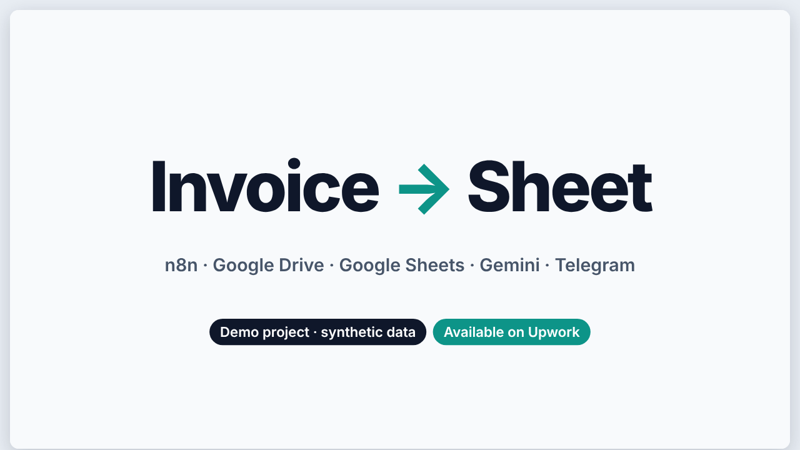
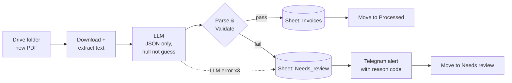

<div align="center">

# 🧾 Invoice PDF → Google Sheet

**n8n workflow that turns invoice PDFs into clean spreadsheet rows. The LLM extracts, deterministic code decides what to trust.**




<sub>Frame from the 40 s animated explainer: <a href="docs/showcase/explainer.html"><code>docs/showcase/explainer.html</code></a> (open locally in a browser).</sub>

</div>

---

## The problem

Someone retypes invoice data by hand. It is slow, and one wrong digit in a total goes unnoticed. A raw LLM does not fix this: it can invent an invoice number or quietly "correct" a total that is printed wrong.

## The approach

Drop a PDF into a Drive folder. It lands in a Sheet, or in a review queue with a Telegram alert and a reason code. Nothing reaches the clean sheet unless it passes validation.



## Validation (`app/code/validate.js`)

| Check | Failure code |
|---|---|
| Valid JSON, all schema keys present | `JSON_PARSE_FAILED` · `SCHEMA_KEYS_MISSING` |
| Required fields present, no `N/A` placeholders | `MISSING_INVOICE_NUMBER` … |
| ISO dates, currency in allowlist (USD / CAD / EUR) | `BAD_ISSUE_DATE` · `CURRENCY_NOT_ALLOWED` |
| subtotal + tax = total (integer cents, ±0.01) | `TOTAL_MISMATCH` |
| qty × unit price = line amount, Σ lines = subtotal | `LINE_n_AMOUNT_NE_QTY_X_PRICE` · `LINES_SUM_NE_SUBTOTAL` |
| **Grounding:** invoice number, subtotal, total, tax must literally appear in the PDF text | `NOT_IN_SOURCE_*` |

The grounding check catches hallucinated numbers and an LLM "fixing" a wrong printed total.

The dataset has two deliberate traps: `invoice_05` (printed total ≠ subtotal + tax) and `invoice_08` (no invoice number). Both must end up in `Needs_review`.

## Results

<!-- GLANCE -->
| Replay: fields correct | Replay: routing | Live export: fields correct | Validator tests |
|:-:|:-:|:-:|:-:|
| **90/90** | **10/10** | **72/72** | **16/16** |
<!-- /GLANCE -->

<details>
<summary><b>Full tables</b> (generated by <code>make showcase</code> from <code>eval/*.json</code>, not typed by hand)</summary>

<!-- RESULTS -->
_Generated by `make showcase` from eval/eval.json, eval/eval_live.json, eval/tests.json._

Recorded LLM outputs: 8 live (Gemini), 2 stub (problem files 05, 08, built from ground truth; not live).

**A. Replay (all files)** — _mock-replay: recorded LLM outputs -> app/code/validate.js_

| field | correct | of | accuracy |
|---|---|---|---|
| invoice_number | 10 | 10 | 100.0% |
| vendor | 10 | 10 | 100.0% |
| issue_date | 10 | 10 | 100.0% |
| due_date | 10 | 10 | 100.0% |
| currency | 10 | 10 | 100.0% |
| subtotal | 10 | 10 | 100.0% |
| tax | 10 | 10 | 100.0% |
| total | 10 | 10 | 100.0% |
| line_item_count | 10 | 10 | 100.0% |
| **routing** | 10 | 10 | |
| **failure_code** | 2 | 2 | |
| **all fields** | 90 | 90 | |

**B. Live n8n run export** — _live n8n run (Gemini), Invoices sheet export_

| field | correct | of | accuracy |
|---|---|---|---|
| invoice_number | 8 | 8 | 100.0% |
| vendor | 8 | 8 | 100.0% |
| issue_date | 8 | 8 | 100.0% |
| due_date | 8 | 8 | 100.0% |
| currency | 8 | 8 | 100.0% |
| subtotal | 8 | 8 | 100.0% |
| tax | 8 | 8 | 100.0% |
| total | 8 | 8 | 100.0% |
| line_item_count | 8 | 8 | 100.0% |
| **routing** | 8 | 8 | |
| **failure_code** | 0 | 0 | |
| **all fields** | 72 | 72 | |

**Validator tests:** 16/16 passed (`eval/tests.json`)
<!-- /RESULTS -->

</details>

> **Read this honestly.** The set is 10 synthetic files. In the replay, the two problem files are *stub* outputs derived from ground truth, so the replay proves the validator routes them correctly, not that an LLM extracts them correctly. Live LLM accuracy is evidenced only by the committed live export (passing files). No cost or time-saved figure is shown because none was measured.

## Quick start

```bash
make setup      # needs node, python3, poppler-utils (pdftotext)
make demo       # MOCK mode, zero keys: recorded LLM outputs -> real validator -> compare with ground truth
make eval       # + compare the committed live n8n export -> eval/eval.json, eval/eval_live.json
make test       # validator tests -> eval/tests.json
make showcase   # regenerate docs/showcase/results.md and the results above
make live       # real LLM run, needs ANTHROPIC_API_KEY (see .env.example)
```

<details>
<summary><b>Run it in n8n</b></summary>

1. `docker compose up`, open `http://localhost:5678`.
2. Import `app/workflow/invoice-intake.workflow.json` and `app/workflow/invoice-intake-error.workflow.json`.
3. Create credentials in the UI: Google Drive, Google Sheets, LLM, Telegram. Nothing secret lives in this repo.
4. Replace every `REPLACE_*` value: Drive folder IDs, spreadsheet ID, Telegram chat ID.
5. Sheets need tabs `Invoices` and `Needs_review` with the headers listed in [`docs/showcase/design.md`](docs/showcase/design.md).

The committed workflow uses an Anthropic chat model node; the live run was done with Gemini. Swap the model node to taste.

</details>

## Repo layout

| Path | What |
|---|---|
| [`app/`](app) | validator and preprocess Code nodes, prompts, workflow JSON, builder script |
| [`data/invoices/`](data/invoices) | 10 synthetic PDFs, `expected.csv` ground truth, generator |
| [`data/recorded/`](data/recorded) | recorded LLM outputs for MOCK mode; `manifest.json` marks `live` vs `stub` |
| [`data/live_run/`](data/live_run) | sanitized export of the live n8n run (Drive IDs and links removed) |
| [`eval/`](eval) | compare, validator runner, tests, showcase renderer, outputs `eval.json` · `eval_live.json` · `tests.json` |
| [`docs/showcase/`](docs/showcase) | design doc, explainer, generated `results.md` |

## Limitations

- Free-tier LLM keys hit rate limits (429). The workflow retries 3× and then routes to `Needs_review`. Use a paid key for real volume.
- Drive Trigger polls every minute and fires only for newly created files. Manual "Execute workflow" processes only the latest file.
- Scanned PDFs without a text layer go to `Needs_review` (`NO_TEXT_LAYER`). No OCR.
- A `dedupe_key` column is written, but no duplicate check is implemented.
- Exact-match grounding can false-flag values printed in unusual number formats.
- Tiny synthetic dataset. Accuracy on real-world layouts is unmeasured.
